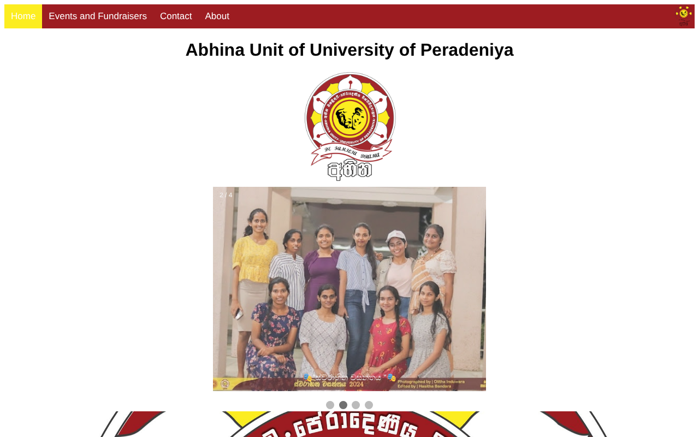

<div align="center">

# Abhina Unit · University of Peradeniya

An early website for the Abhina Unit of the University of Peradeniya, with an image slideshow, events and fundraisers, contact and about sections.

[](https://meshannawod.github.io/Meshan.github.io/)

  



</div>

> An early project (2024). My current portfolio is **[meshannawod.github.io](https://meshannawod.github.io/)**.

## Files

```text
index.html    home page
index1.html   gradient text experiment
main.css      styles
Script.js     slideshow
*.jpg, *.png  logos and slides
```

## Author

Made by **Meshan Nawod**, Physics undergraduate at the University of Peradeniya · [Portfolio](https://meshannawod.github.io/) · [GitHub](https://github.com/MeshanNawod)

## License

This project is licensed under the GNU General Public License v2.0 or later (GPL-2.0-or-later). See [LICENSE](LICENSE).
